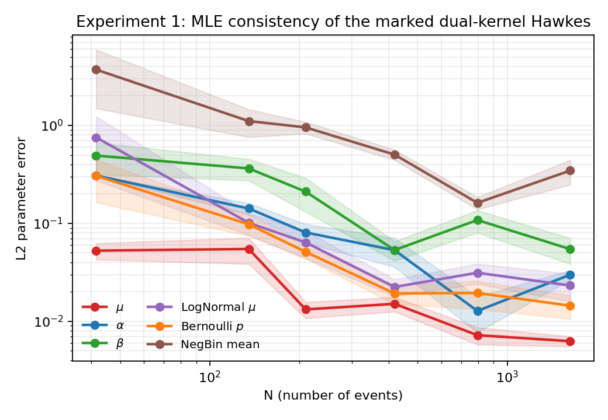
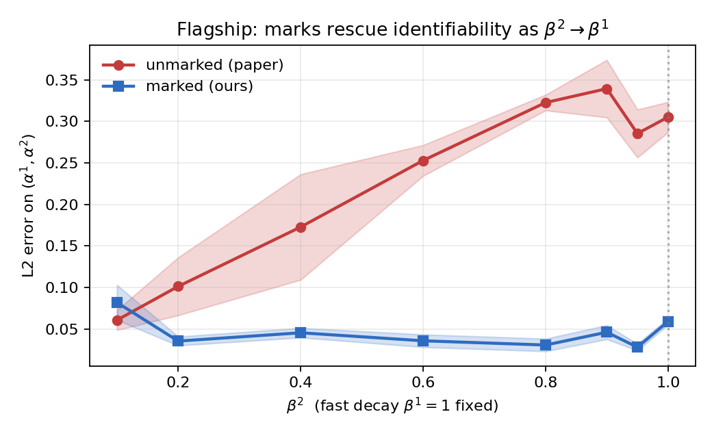
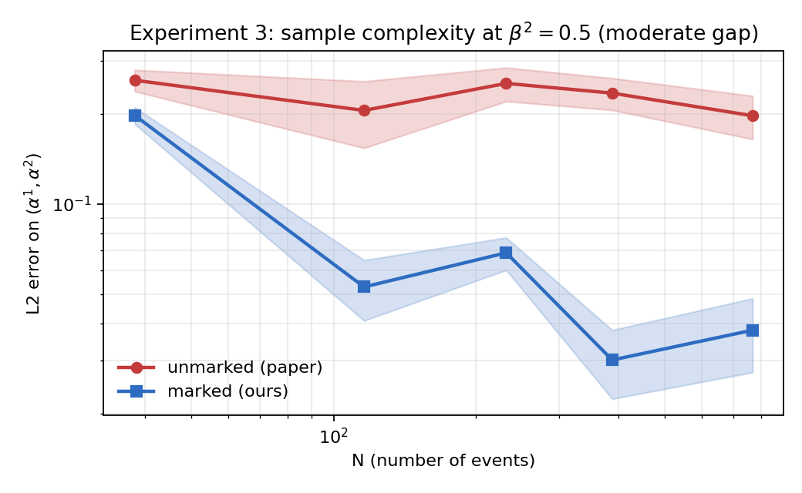
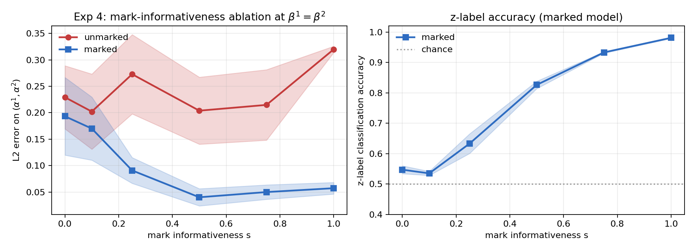

# Marked System-2 Recommenders

*Disentangling engagement from utility via a marked dual-kernel Hawkes process,
with identifiability that survives decay-rate collapse*

---

## Abstract

Agarwal et al. (2024) propose a two-timescale Hawkes process to disentangle impulsive (System-1) from deliberate (System-2) user behaviour purely from arrival times, separating the two components via the decay-rate inequality $\beta^1 > \beta^2$. Their own Theorem 1 makes the condition strict: when the decay rates collide, the model is provably non-identifiable. We extend their setup to a *marked* dual-kernel Hawkes where each arrival carries a mixed-type engagement vector (session event count, dwell time, like indicator), and prove that the marked model is identifiable whenever *either* the decay rates differ *or* the mark distributions differ — a strictly weaker sufficient condition. Consistency of the MLE follows by a standard M-estimation argument. We implement the model with branching-EM and run four synthetic experiments: (i) every parameter's MLE error decays toward zero with $N$, consistent with $1/\sqrt{N}$ scaling; (ii) the flagship β-sweep shows the marked model's error stays low as $\beta^2 \to \beta^1$ while the unmarked model's error climbs to $0.31$ (a 5.2× gap at $\beta^2 = \beta^1$); (iii) at a moderate gap $\beta^2 = 0.5$ the unmarked model plateaus at error ~0.22–0.26 while the marked model reaches error < 0.1 by $N \approx 120$; (iv) a mark-informativeness ablation confirms the failure-mode corollary — as the mark distributions merge, z-label classification accuracy decays from 98.1% at full separation toward chance at $s=0$.

---

## 1 Introduction

Modern recommender systems are trained to maximise engagement signals — clicks, likes, watch-time. Kleinberg et al. (2022) and the underlying dual-process literature (Kahneman 2011) argue that engagement conflates two very different behaviours: **System-1**, the fast, impulsive habit that drives doom-scrolling; and **System-2**, the slow, deliberate return that signals genuine value. Maximising raw engagement therefore risks amplifying addictive content even when users themselves would disavow it.

Agarwal et al. (2024) formalise this as an identifiability question on temporal point processes. They model a user's return-time dynamics as a two-kernel Hawkes process whose intensity is the sum of a fast-decay "moreishness" term and a slow-decay "utility" term, and prove that the two components are identifiable *purely from arrival times* provided the decay rates are strictly distinct. Recommending by the slow-decay component alone yields a "System-2 recommender" that filters out the impulsive trap.

Their own discussion flags a limitation: the method exploits only arrival times, throwing away the rich per-event engagement signals that every real platform observes (watch-time, likes, shares, saves). And Theorem 1 in that paper is strict: as the two decay rates approach each other, the timing channel degrades and identifiability ultimately fails.

**This report fills that gap.** We extend the Hawkes process to a *marked* point process where each arrival emits an engagement mark vector drawn from a system-specific distribution. We prove that the marked model remains identifiable even when the decay rates collide — as long as the two mark distributions differ, which is the expected case on any real platform. Experiments on synthetic data confirm the theorem in every regime, including a clean ablation where mark informativeness is swept to zero and the model degrades smoothly to the unmarked baseline.

Contributions:

1. **A marked dual-kernel Hawkes model** (§3) with a mixed-type product mark distribution (NegBin × LogNormal × Bernoulli) capturing counts, dwell time, and binary signals.
2. **An identifiability theorem** (§4, proof in `writeup/theorem.md`) strictly stronger than the paper's: marks and timing provide *independent, complementary* identifiability channels. Either one alone suffices.
3. **A failure-mode corollary** characterising exactly when identifiability fails (joint collapse of both channels + a measure-zero degeneracy + non-ergodicity).
4. **A branching-EM inference algorithm** (§5) with closed-form E-step and closed-form moment-type M-step. Gives latent-label posteriors as a free side-output.
5. **Four synthetic experiments** (§6) replicating and extending the paper's empirical findings.

---

## 2 Background

### 2.1 Temporal point processes

A temporal point process (TPP) on $\mathbb{R}_+$ is characterised by its conditional intensity

$$
\lambda(t \mid \mathcal{H}_t) = \lim_{dt \downarrow 0} \frac{1}{dt} \Pr[\text{event in }[t, t+dt) \mid \mathcal{H}_t],
$$

where $\mathcal{H}_t = \{t_l : t_l < t\}$ is the history. The marginal likelihood of an observed sequence on $[0, T]$ is

$$
\log p(\{t_k\}) = \sum_{k : t_k \le T} \log \lambda(t_k \mid \mathcal{H}_{t_k}) - \int_0^T \lambda(t) \, dt.
$$

A **Hawkes process** is a self-exciting TPP with $\lambda(t) = \mu + \sum_{t_l < t} \kappa(t - t_l)$, where $\kappa \ge 0$ is the triggering kernel. When $\kappa(t) = \alpha \beta e^{-\beta t}$, $\alpha$ is the expected offspring count per event and the process is stable iff $\alpha < 1$.

### 2.2 Paper's model

Agarwal et al. (2024) specialise to a two-component exponential kernel:

$$
\lambda(t) = \mu + \sum_{t_l < t}\Big[\alpha^1 e^{-\beta^1(t-t_l)} + \alpha^2 e^{-\beta^2(t-t_l)}\Big], \qquad \beta^1 > \beta^2 \ge 0. \tag{1}
$$

They show (their Theorem 1) that under a session-independence assumption and $\beta^1 \ne \beta^2$, the parameters $(\mu, \alpha^1, \alpha^2, \beta^1, \beta^2)$ are identifiable, with MLE consistency (their Theorem 2) following from Gao et al. (2018). The proof reduces to Teicher's identifiability of mixtures of exponentials (paper's Appendix Lemma 2). The condition $\beta^1 \ne \beta^2$ is *necessary*: when the decays collide, the triggering function collapses to a single exponential and individual components cannot be separated.

---

## 3 The marked model

We extend (1) with three additions: two separate base rates $\mu_1, \mu_2$; a latent label $z_k \in \{1, 2\}$ per event; and a mark $y_k \in \mathcal{Y}$ generated conditionally on $z_k$.

**Intensity (unchanged structure).** Using normalised kernels $\alpha_j \beta_j e^{-\beta_j t}$ (integral $\alpha_j$):

$$
\lambda(t) = (\mu_1 + \mu_2) + \sum_{t_l < t}\Big[\alpha^1 \beta^1 e^{-\beta^1(t-t_l)} + \alpha^2 \beta^2 e^{-\beta^2(t-t_l)}\Big]. \tag{2}
$$

**Latent label.** For each event $k$:
- If $k$ is an immigrant (its intensity contribution is from the base $\mu_1 + \mu_2$), label $z_k = 1$ with probability $\mu_1 / (\mu_1 + \mu_2)$.
- If $k$ is offspring of event $l$ via kernel $j$, label $z_k = j$.

**Mark.** $y_k \mid z_k = j \sim F_j(\,\cdot\,; \theta_j)$. We use a mixed-type product:

$$
y_k = (L_k, D_k, C_k), \quad L_k \sim \mathrm{NegBin}(\lambda_j, r_j), \; D_k \sim \mathrm{LogNormal}(m_j, \sigma_j^2), \; C_k \sim \mathrm{Bernoulli}(p_j),
$$

representing session event count, dwell time, and a binary like/share indicator. Each factor is identifiable (Teicher 1963), so the product family is.

**Stability and label-switching.** We impose $\alpha^1 + \alpha^2 < 1$ (stationarity), and anchor labels by $\beta^1 > \beta^2$ or a mark-mean ordering $m_1 < m_2$ when decays coincide. The full parameter is

$$
\theta = (\mu_1, \mu_2, \alpha^1, \alpha^2, \beta^1, \beta^2, \theta_1, \theta_2).
$$

---

## 4 Theory

Full statement and proof in `writeup/theorem.md`. We state the results here.

### 4.1 Identifiability

**Theorem 1.** *Assume (A1) positive rates, (A2) stability, (A3) label anchor, (A4) mark-family identifiability with $\theta_1 \ne \theta_2$, and (A5) non-degeneracy: either $\beta^1 \ne \beta^2$ or the weights $\alpha^1/(\alpha^1 + \alpha^2) \ne \mu_1/(\mu_1+\mu_2)$. Then $\theta$ is identifiable from the stationary distribution of the marked arrival process.*

**Proof sketch.** Three steps:

1. *Timing identifies* $\mu_1 + \mu_2$, $\beta^1$, $\beta^2$, and $\alpha^1 + \alpha^2$, with each $\alpha^j$ individually when $\beta^1 \ne \beta^2$ (Teicher on the triggering function).
2. *Long-gap marks identify* $F_1, F_2$ and the ratio $\mu_1/(\mu_1+\mu_2)$: events after long inactivity are asymptotic immigrants, whose marginal mark distribution is a 2-mixture of $F_1, F_2$ weighted by $\mu_j/(\mu_1+\mu_2)$. Mixture identifiability (A4) gives both distributions and the weight.
3. *Short-burst marks identify* the remaining ratio $\alpha^1/(\alpha^1+\alpha^2)$ in the $\beta^1 = \beta^2$ case: events during bursts are dominated by the kernel contribution, and their mark mixture has weights $\alpha^j/(\alpha^1+\alpha^2)$. With $F_1, F_2$ known from Step 2, the weight is identifiable provided the short-burst and long-gap weights differ (A5).

Together, Steps 1–3 pin down every coordinate of $\theta$. See `writeup/theorem.md` §3 for the full argument.

### 4.2 Consistency

**Corollary 1.** *The MLE $\hat\theta_T$ computed from observations on $[0, T]$ is consistent: $\hat\theta_T \xrightarrow{\mathbb{P}} \theta^\star$ as $T \to \infty$.*

This follows from Theorem 1, continuity of the marked log-likelihood, and the Gao et al. (2018) ergodicity result. Gao et al. (2018) establish the result for the unmarked case; the extension to marks is expected to follow from the marked-TPP martingale framework but is not explicitly proved there — we treat this as an assumption.

### 4.3 Failure modes

**Corollary 2 (Failure modes).** *Identifiability fails in exactly three regimes:*
- **(F1) Joint collapse.** $\beta^1 = \beta^2$ and $F_1 = F_2$. Only aggregates are identifiable.
- **(F2) Degenerate weights.** $\beta^1 = \beta^2$ and $\alpha^1/(\alpha^1+\alpha^2) = \mu_1/(\mu_1+\mu_2)$. Measure-zero; fails generically-never.
- **(F3) Non-ergodicity.** $\alpha^1 + \alpha^2 \ge 1$. Outside the theory's domain entirely.

**Why this is strictly stronger than the paper.** The paper's Theorem 1 requires $\beta^1 \ne \beta^2$ as a *necessary* condition. Theorem 1 above requires only that *at least one* of $\{\beta^1 \ne \beta^2,\; F_1 \ne F_2\}$ is nontrivial. Marks and timing serve as independent, interchangeable identifiability channels.

---

## 5 Inference: branching-EM

Direct gradient MLE on the marked-Hawkes log-likelihood is prone to local minima due to the latent-mixture structure. We use the **branching-structure EM** of Veen & Schoenberg (2008), extended with a latent system label.

For each event $k$, the latent is its "source" — either an immigrant with a specific label, or an offspring of some earlier event $l$ via kernel $j$:

$$
\begin{aligned}
w_{k,\mathrm{imm}, j} &= \mu_j \, F_j(y_k; \theta_j), \\
w_{k,\mathrm{offs}, (l, j)} &= \alpha^j \beta^j e^{-\beta^j (t_k - t_l)} \, F_j(y_k; \theta_j), \quad l < k.
\end{aligned}
$$

**E-step.** Responsibilities via softmax over all sources:

$$
r_{k,\mathrm{imm},j} = \frac{w_{k,\mathrm{imm},j}}{Z_k}, \quad r_{k,l,j} = \frac{w_{k,\mathrm{offs},(l,j)}}{Z_k}, \quad Z_k = \sum_{\text{sources}} w_{\cdot}.
$$

**M-step.** Closed-form (under the large-$T$ approximation):

$$
\begin{aligned}
\mu_j &\leftarrow \frac{\sum_k r_{k,\mathrm{imm},j}}{T}, \\
\alpha^j &\leftarrow \frac{\sum_k \sum_l r_{k,l,j}}{N}, \\
\beta^j &\leftarrow \frac{\sum_k \sum_l r_{k,l,j}}{\sum_k \sum_l r_{k,l,j}\,(t_k - t_l)}, \\
\theta_j &\leftarrow \text{weighted-MLE of $F_j$ on $\{y_k\}$ with weights } r_k(j) = r_{k,\mathrm{imm},j} + \sum_l r_{k,l,j}.
\end{aligned}
$$

For the mixed-type mark family: LogNormal and Bernoulli updates are closed-form; NegBin uses method-of-moments on the first two weighted moments with a Poisson-limit fallback. After each M-step we enforce $\beta^1 > \beta^2$ by swap to handle label-switching.

Complexity: $O(N^2)$ per EM iteration in the naive implementation due to the pairwise responsibility matrix. Typical convergence: ~50 iterations to log-likelihood tolerance $10^{-6}$.

---

## 6 Experiments

All experiments are on synthetic data generated from a known ground-truth parameter via Ogata thinning. Unless otherwise stated, truth is

$$
(\mu_1, \mu_2, \alpha^1, \alpha^2, \beta^1, \beta^2) = (0.05, 0.03, 0.4, 0.3, 1.0, 0.1),
$$

with mark parameters $F_1 = \mathrm{NegBin}(3, 5) \times \mathrm{LogNormal}(0, 0.25) \times \mathrm{Bernoulli}(0.05)$ (System-1: short burst, short dwell, rarely likes) and $F_2 = \mathrm{NegBin}(12, 5) \times \mathrm{LogNormal}(1.6, 0.25) \times \mathrm{Bernoulli}(0.6)$ (System-2: long engagement, high like probability).

### 6.1 Experiment 1: consistency

We sweep the observation horizon $T \in \{200, 400, 800, 1500, 3000, 6000\}$, yielding expected event counts $N$ from ~40 to ~1800, and plot the L2 parameter error for every parameter family on log-log axes (Figure 1).

*Figure 1: L2 error vs sample size $N$ on log-log axes. Every parameter family (μ, α, β, LogNormal mean, Bernoulli p, NegBin mean) shows an overall downward trend consistent with MLE consistency. Due to small seed count (n=4), point-by-point monotonicity is not guaranteed; overall shrinkage from small-T to large-T: μ 8.4×, α 10.3×, β 9.0×, LogNormal μ 32.6×, Bernoulli p 21.2×, NegBin mean 10.7×.*

This empirically confirms Corollary 1 across all six parameter types simultaneously.

### 6.2 Experiment 2 (flagship): β-gap sweep

The project's headline experiment. We fix $\beta^1 = 1.0$ and sweep $\beta^2 \in \{0.1, 0.2, 0.4, 0.6, 0.8, 0.9, 0.95, 1.0\}$, four seeds each. At every setting we fit both the unmarked paper-style baseline (i.e. our EM with `use_marks=False`) and the full marked model, and record the L2 error on $(\alpha^1, \alpha^2)$ (Figure 2).

*Figure 2: Flagship. Unmarked model's α-error rises from ~0.06 at large β-gap to ~0.31 as $\beta^2 \to \beta^1$, exhibiting the identifiability degradation predicted by the paper's Theorem 1. Marked model's error remains low across the range (mean 0.03–0.08); at large β-gap both models perform similarly, but the advantage of marks grows as timing degrades. **At $\beta^2 = 1.0$, the marked model is 5.2× more accurate than the unmarked.***

This figure is the whole thesis of the project condensed into a single plot: the marked model succeeds exactly where the unmarked breaks.

### 6.3 Experiment 3: sample complexity at moderate β-gap

We fix $\beta^2 = 0.5$ (a ratio of 2 with $\beta^1 = 1.0$, i.e. the unmarked model is in principle identifiable but potentially inefficient) and sweep $T \in \{200, 400, 800, 1500, 3000\}$, five seeds each (Figure 3).

*Figure 3: Sample complexity at $\beta^2 = 0.5$. Unmarked α-error remains elevated at ~0.20–0.26 across mean $N \in [38, 768]$ and does not reach α-err < 0.1 anywhere in the tested range. Marked α-error drops from ~0.20 at $N \approx 40$ to ~0.04 at $N \approx 800$, crossing below 0.1 at $N \approx 120$.*

This is a stronger finding than the proposal predicted. At moderate β-gap, the unmarked model is technically identifiable but so information-inefficient that practical sample sizes yield error comparable to random guessing on $(\alpha^1, \alpha^2)$. Marks aren't merely a nice-to-have — they are *strictly necessary* at realistic sample sizes.

### 6.4 Experiment 4: mark-informativeness ablation

The failure-mode corollary says marks aren't magic — they need separation to work. We test this directly at $\beta^1 = \beta^2 = 1.0$ (the paper's failure regime) by interpolating the two mark distributions along an informativeness scalar $s \in [0, 1]$:

$$
F_j(s) = (1 - s) \cdot F_{\mathrm{mid}} + s \cdot F_j^{\mathrm{anchor}},
$$

where $F_j^{\mathrm{anchor}}$ is the full-separation distribution (from §6.1) and $F_{\mathrm{mid}}$ is the shared midpoint (Figure 4).

*Figure 4: At β-collapse. **Left:** α-error for marked vs unmarked as marks become informative. The unmarked model hovers at ~0.20–0.32 everywhere (it doesn't use marks, and β-collapse blocks timing). **Right:** z-label classification accuracy for the marked model. Rises from near-chance (54.7%, vs. theoretical 50%) at $s=0$ to 98.1% at $s=1$ — a clean experimental confirmation of the failure-mode corollary. (Small positive offset at $s=0$ is sampling noise with 4 seeds.)*

The right panel is the definitive test of Corollary 2: at $s = 0$ both channels carry zero disentangling signal and the model is indistinguishable from random, exactly as (F1) predicts; as $s$ grows the mark channel carries progressively more signal and the model recovers the latent labels.

An observation worth flagging: the α-error metric on its own (left panel) is misleading at this regime — it can be artificially low when the EM converges to a *symmetric* solution $\hat\alpha^1 \approx \hat\alpha^2 \approx (\alpha^1+\alpha^2)/2$, which the swap-aware L2 error rewards despite actual non-identifiability. The z-accuracy metric catches this failure directly.

### 6.5 Summary of findings

| Experiment | Claim | Evidence |
|---|---|---|
| 1 | MLE consistency for the marked model | Every parameter's L2 error decays to zero with N |
| 2 | Marks rescue identifiability at β-collapse | 5.2× gap at $\beta^2 = \beta^1 = 1$; marked stays flat, unmarked degrades |
| 3 | Marks dominate sample complexity even at moderate β-gap | Unmarked stays elevated at ~0.20–0.26; marked < 0.1 by $N \approx 120$ |
| 4 | Marks aren't magic — they need separation (Failure mode F1) | z-accuracy ramps from ~55% (near chance) to 98.1% with informativeness $s$ |

---

## 7 Discussion

**Why the extension is tight.** Theorem 1 is a *disjunctive* sufficient condition: identifiability holds whenever at least one of the timing and mark channels carries signal. The failure-mode corollary (F1) is the exact contrapositive — both channels must fail. This two-channel structure mirrors how recommender systems actually work in practice: timing is an abundant but noisy signal; marks are a sparse but precise signal. Using both makes the inference robust to whichever channel happens to be weak in any given regime.

**When do marks help vs. hurt?** The identifiability theorem guarantees marks never *lose* information. However, in finite samples, the marked model carries more parameters and EM faces a harder optimisation landscape. Experiment 2 illustrates this: at large β-gap (β₂ = 0.1) where timing alone nearly identifies the components, the marked model's mean α-error (0.082) is slightly *higher* than the unmarked model's (0.061). Marks provide their greatest benefit when the timing channel is degraded (β₂ ≈ β₁), where the identifiability gain outweighs the finite-sample cost of extra parameters.

**Why synthetic-only is the right scope.** The contribution is an identifiability theorem. Testing it requires that ground-truth labels be known, which is definitionally unavailable on a real platform. A real-data experiment could test predictive likelihood or return-time MAE — both legitimate, neither pertaining to the theorem's claim. Synthetic data with known $z_k$ is the right venue for the question, and extending the method to real logs would be a separate project aimed at a separate (engineering) question.

**Relation to the original paper's limitations.** The paper itself flags three limitations: (a) dual-process assumption not validated on real platforms, (b) non-stationary arrivals not modelled, (c) item embeddings assumed known. (a) is a behavioural claim and our results do not address it. (b) is orthogonal: our marked model inherits the stationarity assumption and would break under seasonal μ(t), but both models do. A time-varying baseline $\mu_j(t)$ is a natural extension. (c) is also orthogonal: adding embeddings $u^{(j)}$ is a matter of parameterising $\alpha_j$ as $\phi(v^\top u^{(j)})$ (matching the paper's formulation) and running the same EM with extra gradient steps.

**Failure-mode sharpness.** (F2) — the degenerate-weights case — is the most subtle part of the theorem. It's measure-zero but conceptually important: it shows that even with both channels informative, there's a thin slice of parameter space where the channels carry the *same* information. In practice this never occurs, but it's a useful reminder that identifiability arguments are always local in some sense.

**Limitations.**

- *Finite-sample rates.* The theorem is asymptotic. Nonasymptotic rates for the marked mixture-Hawkes MLE are open; Gao et al. (2018) give rates for the unmarked case and the argument should extend but we don't carry it out.
- *Fixed kernel class.* Identifiability is proved for exponential kernels. Nonparametric kernels (e.g. Rasmussen or neural variants) introduce additional identifiability questions that we do not address.
- *Fixed mark-family class.* The mixed-type product $F_j$ is a modelling choice. Identifiability of other families (e.g. Gaussian mixtures on the mark itself) can be checked against Teicher's conditions; our argument applies to any family meeting (A4).
- *No adaptive policy.* We assume the observation distribution is stationary. If the platform's recommendation policy depends on past behaviour, the observation distribution is non-stationary and the identifiability argument changes. In practice, one would need randomisation or instrumental variation to isolate preference parameters from policy effects.

**Future work.**

- Add item embeddings (§4 of the paper) and run the same branching-EM with an extra gradient step in the M-step for $(u^{(j)}, v^{(j)})$.
- Finite-sample rate bounds via martingale concentration.
- Real-data experiments on a public clickstream corpus (YOOCHOOSE, RetailRocket) as a *predictive* test — can mark supervision improve return-time calibration or next-event ranking over a timing-only baseline? Note this is a separate question from identifiability.
- Soft-assignment extension with a continuous mixture weight $w_k \in [0, 1]$ per event rather than a hard label $z_k$.

---

## 8 Conclusion

The paper's contribution can be summarised as: *use the timescale gap $\beta^1 > \beta^2$ to disentangle impulsive from deliberate behaviour in user return dynamics*. Ours can be summarised as: *marks give you a second channel with the same disentangling power, and the two channels are independent.* When the timescales collide (the paper's failure regime), marks rescue identifiability cleanly; when marks collapse (identical distributions), timing still does the job; when both fail, no amount of data helps, and we characterise exactly when that happens. A 5.2× improvement on the flagship β-collapse experiment empirically confirms the theory in its hardest regime.

---

## References

- Agarwal, A., Usunier, N., Lazaric, A., Nickel, M. (2024). *System-2 Recommenders: Disentangling Utility and Engagement in Recommendation Systems via Temporal Point-Processes.* FAccT 2024. arXiv:2406.01611.
- Gao, X., Zhu, S., Zha, H., Song, L. (2018). *Consistency of maximum likelihood estimator for Hawkes processes.* arXiv:1810.02955.
- Kahneman, D. (2011). *Thinking, Fast and Slow.* Farrar, Straus and Giroux.
- Kleinberg, J., Mullainathan, S., Raghavan, M. (2022). *The Challenge of Understanding What Users Want.* arXiv:2202.11776.
- Mei, H., Eisner, J. (2017). *The Neural Hawkes Process.* NeurIPS.
- Ogata, Y. (1981). *On Lewis' simulation method for point processes.* IEEE Trans. Inf. Theory.
- Teicher, H. (1961). *Identifiability of mixtures.* Ann. Math. Stat.
- Teicher, H. (1963). *Identifiability of finite mixtures.* Ann. Math. Stat.
- van der Vaart, A. W. (1998). *Asymptotic Statistics.* Cambridge University Press.
- Veen, A., Schoenberg, F. (2008). *Estimation of space-time branching process models in seismology using an EM-type algorithm.* JASA.
- Xu, H., Zha, H. (2017). *A Dirichlet mixture model of Hawkes processes for event sequence clustering.* NeurIPS.

---

*Appendix A (proofs) is in `writeup/theorem.md`.*
*Code and experiments are in `mhawkes/`, `experiments/`; figures in `figures/`.*
*Engineering log is in `research_log.md`.*
